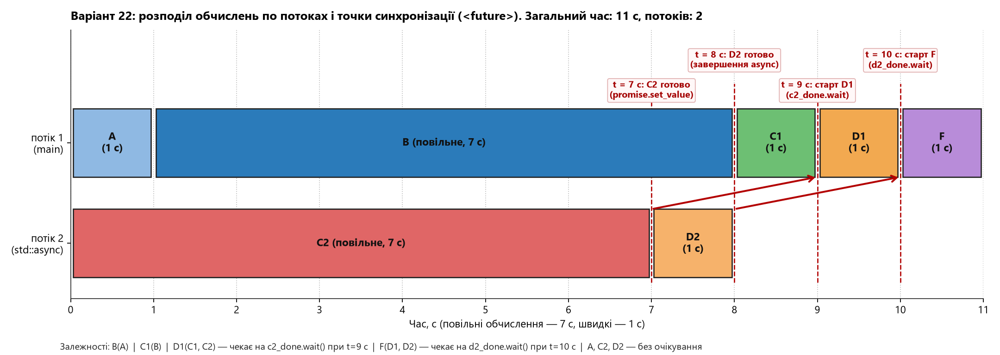
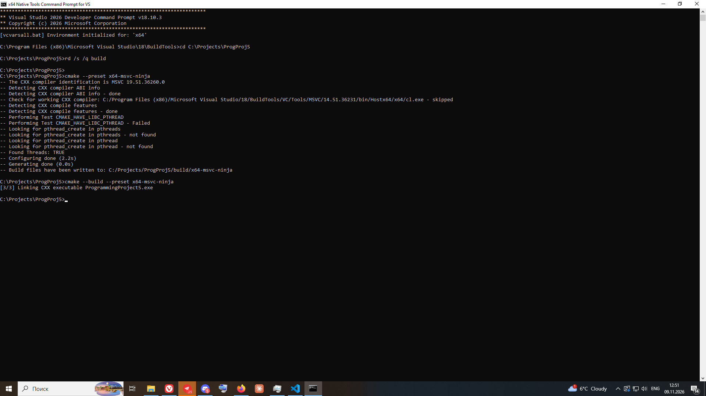

# Програмний проєкт №5

Асинхронне виконання комплексу залежних обчислень («повільних» і «швидких») за допомогою
засобів бібліотеки `<future>` за мінімальний загальний час та з мінімальною кількістю потоків.
**Варіант 22:** обчислення `A, B, C1, C2, D1, D2, F`; повільні — `B, C2`; залежності — `B(A)`,
`C1(B)`, `D1(C1, C2)`, `F(D1, D2)`.

**Виконавець:** Корпачов Артем Андрійович (виконується одноосібно). Група К-27, 2 курс,
факультет комп'ютерних наук та кібернетики КНУ імені Тараса Шевченка, спеціальність F3
«Комп'ютерні науки», освітня програма «Інформатика». Дисципліна: «Програмування мовою
C++. Додаткові розділи».

## Умова

Задано перелік обчислень, поділених на «повільні» (виконуються 7 секунд, функція
`slow(name)`) та «швидкі» (виконуються 1 секунду, функція `quick(name)`), а також відношення
залежності між ними. Запис `X(Y, Z)` означає, що обчислення `X` можна розпочати лише після
завершення обчислень `Y` та `Z` (відношення транзитивне). Незалежні обчислення можна
виконувати одночасно або в довільному порядку.

Потрібно розробити схему виконання та реалізувати функцію `work()`, яка виконує всі
обчислення за допомогою засобів `<future>` так, щоб:
1. Загальний час роботи був мінімальним.
2. За досягнення мінімального часу одночасно працювало якомога менше потоків.
3. Кількість запусків додаткових потоків була мінімальною.

Після завершення всіх обчислень функція `work()` виводить час виконання в секундах та
повідомлення `Work is done!`. Виведення синхронізується через `std::osyncstream`.

## Варіант 22 як залежності

| Обчислення | Тип | Тривалість, с | Починається після завершення |
| --- | --- | --- | --- |
| `A` | швидке | 1 | — |
| `B` | повільне | 7 | `A` |
| `C1` | швидке | 1 | `B` |
| `C2` | повільне | 7 | — |
| `D1` | швидке | 1 | `C1`, `C2` |
| `D2` | швидке | 1 | — |
| `F` | швидке | 1 | `D1`, `D2` |

## Розв'язок

* Крім основного потоку (`main`), запускається **рівно один додатковий потік** через
  `std::async(std::launch::async, ...)`.
* Основний потік послідовно виконує критичний ланцюжок: `A` → `B` → `C1` → `D1` → `F`.
* Додатковий потік паралельно виконує незалежні обчислення: `C2` → `D2`.
* **Точка синхронізації 1 (`std::promise<void>` / `std::future<void>`):** одразу після
  завершення `C2` (на 7-й с) додатковий потік викликає `promise.set_value()`. Основний потік
  перед запуском `D1` (на 9-й с) викликає `c2_done.wait()`.
* **Точка синхронізації 2 (`std::future<void>` від `std::async`):** перед запуском `F`
  (на 10-й с) основний потік викликає `d2_done.wait()`, очікуючи завершення `D2` (яке
  завершується на 8-й с).
* Вивід у консоль захищено через `std::osyncstream(std::cout)`.

### Чому час і кількість потоків мінімальні

Ланцюжок `A → B → C1 → D1 → F` є строго послідовним (кожне наступне обчислення залежить
від попереднього). Його сумарна тривалість становить `1 + 7 + 1 + 1 + 1 = 11 с`. Отже, за
будь-якої кількості потоків виконати комплекс швидше ніж за **11 с** неможливо.

Сумарна тривалість усіх сімох обчислень дорівнює `1 + 7 + 1 + 7 + 1 + 1 + 1 = 19 с`. Оскільки
`19 > 11`, одного потоку недостатньо. У наведеній схемі всі обчислення вкладаються рівно в
**11 с** за використання **2 одночасно працюючих потоків** (`main` + 1 додатковий потік,
1 виклик `std::async`). Обидва очікування (`c2_done.wait()` при `t = 9 с` та `d2_done.wait()`
при `t = 10 с`) не створюють затримок, бо `C2` завершується о `t = 7 с`, а `D2` — о `t = 8 с`.

| Секунда | Потік 1 (`main`) | Потік 2 (`std::async`) | Зайнято потоків |
| --- | --- | --- | --- |
| 1 | `A` (1/1) | `C2` (1/7) | 2 |
| 2–7 | `B` (1..6/7) | `C2` (2..7/7) → `promise.set_value()` | 2 |
| 8 | `B` (7/7) | `D2` (1/1) → завершення потоку | 2 |
| 9 | `C1` (1/1) | — | 1 |
| 10 | `c2_done.wait()` → `D1` (1/1) | — | 1 |
| 11 | `d2_done.wait()` → `F` (1/1) | — | 1 |

## Діаграма (Звіт)

На діаграмі: рядок — потік, блок — обчислення з тривалістю, червоні пунктири та стрілки —
точки синхронізації між потоками через `std::promise` / `std::future`.



## Збирання

* C++23, MSVC 19.51.36260 (Visual Studio 2026 / Build Tools v18.10.3); використано
  `<future>`, `<syncstream>`, `<chrono>`, `<thread>`.
* CMake 3.25+, Ninja, x64.

У **x64 Native Tools Command Prompt for VS 2026**:

```bat
cd C:\Projects\ProgProj5
cmake --preset x64-msvc-ninja
cmake --build --preset x64-msvc-ninja
```

## Запуск

```bat
build\x64-msvc-ninja\ProgrammingProject5.exe
build\x64-msvc-ninja\ProgrammingProject5.exe > results.txt
```

Вивід програми (`results.txt`):

```text
A
C2
B
D2
C1
D1
F
Execution time: 11.04 seconds.
Work is done!
```

## Скріншоти

Збирання:



Робота програми:


## Структура проєкту

```text
ProgProj5/
├── .gitignore
├── CMakeLists.txt
├── CMakePresets.json
├── README.md
├── diagram.png               діаграма розподілу обчислень і точок синхронізації (звіт)
├── results.txt               вивід програми
├── screenshots/
│   ├── build.png             результат збирання
│   └── run.png               результат роботи програми
└── src/
    ├── main.cpp              точка входу, виклик work()
    ├── work.h                оголошення функцій slow, quick та work
    └── work.cpp              схема обчислень (std::async, std::future, std::promise)
```